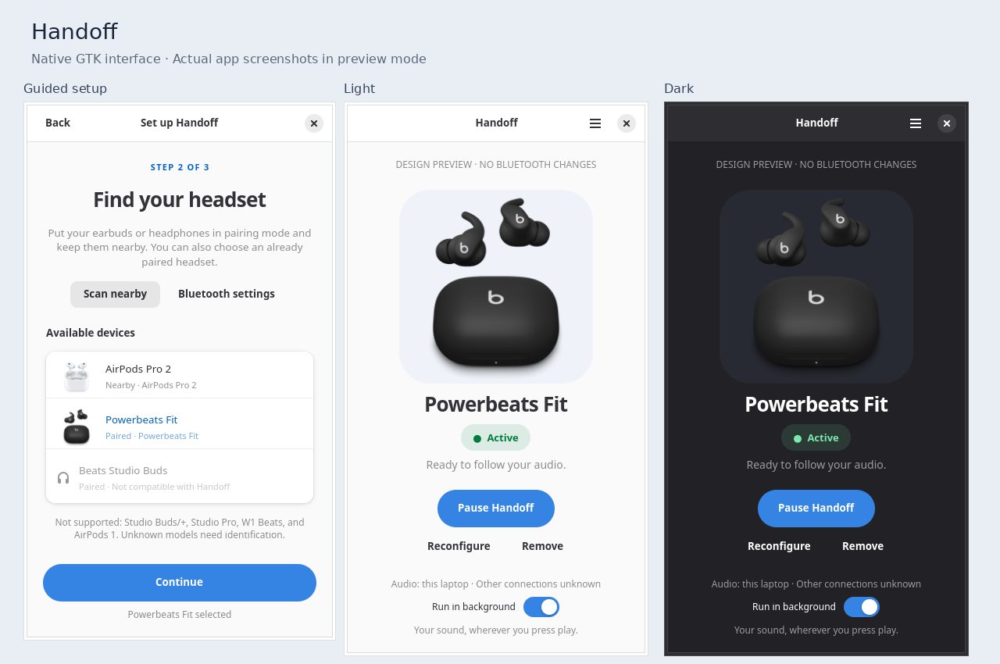

# Handoff Vibe
A compact **AI-Slopped** GTK 4/libadwaita home for [xatuke/handoff](https://github.com/xatuke/handoff). (mb y'all)




## Table of Contents 
* [Features](#features)
* [Requirements](#requirements)
* [Supported Devices](#supported-devices)
* [Installation](#installation-and-first-time-setup)
* [Setup](#installation-and-first-time-setup)
* [Common Issues](#common-issues)


## Features
-   Three-step graphical setup: prepare Bluetooth, select a headset, and confirm its model and background behavior.
-   One-time Bluetooth Device ID preparation through a PolicyKit administrator prompt.
-   Backup of the original Bluetooth configuration before modification, with configuration rollback if the Bluetooth restart fails.
-   Discovery of nearby Bluetooth devices and selection of already paired headsets.
-   Pairing and connection through BlueZ, using the desktop's Bluetooth agent when confirmation is required.
-   Shortcuts to the desktop's Bluetooth settings.
-   Model identification using supported Bluetooth product IDs and Apple proximity data exposed by BlueZ.
-   Explicit model confirmation when identification relies on a device name.
-   Manual model selection for an unidentified or renamed headset.
-   Rejection of known incompatible product IDs and known unsupported models.
-   Model-specific product photographs and the headset's Bluetooth name on the main page.
-   Reconfigure an existing headset or remove its Handoff Vibe profile.
-   Removing a headset stops and disables its Handoff service while keeping its Bluetooth pairing.


## Requirements
| Component | Requirement |
| --- | --- |
| Operating system | Linux with BlueZ, D-Bus, and a working systemd user session |
| Provided `.deb` | Built on Debian 13 for amd64; other distributions and architectures are not validated by this build |
| Bluetooth | Working Bluetooth adapter and a headset eligible for the switching protocol |
| Audio | PulseAudio, or PipeWire with its PulseAudio compatibility service; `pactl` must work |
| GUI runtime | Python 3.10+, PyGObject, GTK 4.8+, and libadwaita 1.3+ |
| Audio engine | Qt 6 Core, Bluetooth, and D-Bus libraries compatible with the compiled binary |
| Setup authorization | PolicyKit/`pkexec` and a desktop authentication agent for the one-time Bluetooth configuration change |
| Pairing | A desktop Bluetooth agent for pairing confirmation when needed |
| Optional indicator | GNOME Shell 48; other Shell versions are not declared compatible in the extension metadata |

The supplied binary requires the library versions recorded in its Debian package metadata, including Qt Core 6.8.2 or newer. Do not assume the provided `.deb` will install on every Debian or Ubuntu release; older systems may need a source build against their own libraries.

The GUI uses `Adw.Banner`, available since libadwaita 1.3. The current packaging script declares a looser 1.2 minimum, so use **1.3 or newer** for the actual GUI runtime, including source builds. See the [libadwaita API reference](https://gnome.pages.gitlab.gnome.org/libadwaita/doc/1.3/class.Banner.html).

No Apple Account credentials or companion iPhone application are requested by Handoff Vibe. Product photos and daily verses are bundled, with no runtime download required for those features.


### Useful paths

| Purpose | Default path |
| --- | --- |
| GUI configuration | `~/.config/handoff/gui.json` |
| Original service backups | `~/.config/handoff/backups/` |
| GUI service template | `~/.config/systemd/user/handoff@.service` |
| Conventional CLI service | `~/.config/systemd/user/airpods-handoff.service` |
| Engine status files | `$XDG_RUNTIME_DIR/handoff/<MAC-without-colons>.json` |
| Packaged engine | `/usr/libexec/ha## Current headset compatibility

The following models are in the current setup catalog. **Catalog eligibility is not a promise that switching has been verified on every model, firmware version, or Bluetooth adapter.** A successful Bluetooth connection alone also does not confirm switching support.
## Supported Devices
| Model | Chip family in the catalog | Identification notes |
| --- | --- | --- |
| AirPods 2 | H1 | Product ID supported; name-based matches require confirmation |
| AirPods 3 | H1 | Product ID supported; name-based matches require confirmation |
| AirPods 4 | H2 | Standard and ANC product IDs included |
| AirPods Pro | H1 | First-generation Pro product ID included |
| AirPods Pro 2 | H2 | Lightning and USB-C product IDs included |
| AirPods Max | H1 | Lightning and USB-C product IDs included |
| Beats Fit Pro | H1 | Product ID supported; name-based matches require confirmation |
| Powerbeats Fit | H1 | No dedicated product ID is mapped in this catalog; model confirmation is required |
| Powerbeats Pro | H1 | Product ID supported; name-based matches require confirmation |
| Powerbeats Pro 2 | H2 | Product ID supported; name-based matches require confirmation |
| Beats Solo Pro | H1 | Product ID supported; name-based matches require confirmation |

### Unsupported or unverified devices

- First-generation AirPods.
- Beats Studio Buds and Studio Buds +.
- Beats Studio Pro and Studio3.
- Beats Solo Buds, Solo3, and Solo 4.
- Beats Flex, BeatsX, and known W1-only models such as Powerbeats 3.
- Devices outside the catalog, unless the user identifies them as an exact catalog model.
- Future or otherwise unmapped models have no claimed support.

Known incompatible product IDs cannot be overridden through the model picker. A friendly Bluetooth name is only a hint: names can be changed, and the app does not cryptographically authenticate hardware.

## Installation and first-time setup

### Install the Debian package

Open `handoff-vibe_X.X.X_amd64.deb` in a graphical package installer that can resolve dependencies and package conflicts, then launch **Handoff Vibe** from the application menu.

Terminal alternative, from the folder containing the package:

```sh
sudo apt install ./handoff-vibe_X.X.X_amd64.deb
```

### Configure a headset

1. Turn on Bluetooth and keep the headset nearby.
2. Open Handoff Vibe and select **Set up a headset**.
3. If prompted, choose **Prepare Bluetooth** and approve the administrator request.
4. Put the headset in pairing mode, select **Scan nearby**, and choose the headset.
5. Confirm the exact model. If necessary, use **Bluetooth settings** to complete pairing, or **Identify** for a renamed device whose model cannot be read automatically.
6. Choose whether to run in the background and start at sign-in, then finish setup.
7. Keep the headset paired with the Apple device you want to switch to, too.
8. Wear the headset and test playback on the laptop and Apple device. Check the device status and Advanced logs if switching does not work.

Bluetooth preparation sets the following value in the `[General]` section of `/etc/bluetooth/main.conf`:

```ini
DeviceID = bluetooth:004C:0000:0000
```

This advertises Apple's Bluetooth vendor ID; it does not turn Linux into a complete macOS or iCloud client. The helper backs up the configuration and restarts Bluetooth, temporarily disconnecting Bluetooth peripherals. A previously paired headset may need to be removed and paired again because it can cache the computer's Bluetooth identity.

## Existing installations and updates

Close the old GUI before installing an updated package.

The current `handoff-vibe` package declares `Conflicts: handoff` and `Replaces: handoff` to transition from the earlier package named `handoff`. Use a package installer or APT that handles the replacement.

The configuration directory, desktop application ID, engine location, and audio-service names retain their historical names for compatibility. The primary launcher is `handoff-vibe`; `/usr/bin/handoff` is a legacy command alias.

When a conventional CLI installation is found, Handoff Vibe can migrate:

```text
~/.config/systemd/user/airpods-handoff.service
```

Automatic migration expects a recognizable Handoff executable and Bluetooth address. Custom service names, system-wide services, symlinked service files, and unidentified models are not silently migrated. An unidentified model may require confirmation in setup.

Migration preserves the original service file and startup/activity state in a backup. If it fails, the app attempts to restore the original service.

### Return to CLI management

Use **Preferences → Restore CLI version**, or **Transition to CLI version** when no original backup exists.

- Restoring a backup requires the original executable to still exist and be executable.
- Transitioning without a backup uses the packaged engine, so the package must remain installed while that CLI service is in use.
- The GUI stops managing the engine in CLI mode and does not immediately re-import it.
- Use **Move back to GUI** to opt back into GUI management.

## Background operation

The background switch enables the selected headset's systemd user service at **user sign-in**, not before login.

| Setting | Normal behavior |
| --- | --- |
| Background enabled | Engine starts at sign-in and stays running after the GUI closes |
| Background disabled | Automatic startup is disabled; the current session can keep running until the GUI closes normally |
| Pause | Stops the engine for now; an enabled startup setting is not automatically removed |
| Remove headset | Stops and disables its managed engine, and removes the GUI profile while retaining Bluetooth pairing |
| CLI mode | The restored or generated CLI service manages switching independently of the GUI controls |

## Status reference

| Status | Meaning |
| --- | --- |
| Not set up | No headset is configured in the GUI |
| Connected / Starting | Bluetooth can be connected while the engine is still starting or waiting for its switching handshake |
| Active | Recent engine telemetry reports a completed switching-protocol handshake |
| Switching audio | A short pending audio-ownership request; this alone does not prove sound reached the headset |
| Disconnected | The configured headset is not connected to this laptop |
| Paused | The GUI-managed engine is not running |
| Error | A service, protocol, or integration operation needs attention; inspect Advanced logs or the error details |
| CLI mode | Switching is managed by the command-line service |
| Waiting / Unavailable | Indicator states used when it cannot confirm a ready engine or access the required session service |

The audio-owner line can identify **this laptop**, **another device**, or **no active source** when the headset reports that information. It does not identify the other device by a friendly name or provide a reliable count of connected devices.

## GNOME top-bar indicator

The optional extension targets **GNOME Shell 48** and can operate without keeping the application window open.

1. Install the package.
2. After the first extension installation, sign out and back in once so GNOME discovers it.
3. Open **Preferences → GNOME integration → Top-bar status** and enable it.
4. Use **Check** to refresh the extension status if needed.

The indicator shows the current headset name in its menu and provides **Open Handoff Vibe**. Its state is based on systemd and recent engine telemetry; it is not an independent Bluetooth scanner.

Extension UUID:

```text
handoff-vibe@asensado.github.io
```

## Experimental multiple-headset profiles

Enable **Preferences → Experimental → Multiple headset profiles**, then use **Add another headset**.

This saves multiple profiles and lets you select the headset to manage. It does **not** provide simultaneous audio output to multiple headsets: only the selected profile is managed at a time. Selecting another profile stops and disables the previously selected engine.

## Debugging

### Start with the GUI

Open **Menu → Advanced logs** or **Preferences → Advanced → Diagnostic logs**.

- Logs show recent output from the selected headset's systemd service, or the conventional CLI service in CLI mode.
- The current viewer retrieves up to 220 recent journal entries and refreshes approximately every three seconds.
- **Refresh logs** requests an immediate update.
- **Copy** copies the displayed text to the clipboard.
- Logs may contain headset names and Bluetooth addresses; review them before posting publicly.

### Inspect Bluetooth and the audio server

```sh
bluetoothctl devices
bluetoothctl info AA:BB:CC:DD:EE:FF
pactl info
pactl list cards short
pactl list sinks short
```

Replace `AA:BB:CC:DD:EE:FF` with your headset's actual Bluetooth address. If `pactl` cannot connect to an audio server, resolve the PulseAudio or PipeWire-Pulse session issue first.

### Inspect the background service

Discover managed units:

```sh
systemctl --user list-units --all 'handoff@*.service'
```

For a headset at `AA:BB:CC:DD:EE:FF`, the GUI unit is `handoff@AABBCCDDEEFF.service`:

```sh
systemctl --user status handoff@AABBCCDDEEFF.service --no-pager
journalctl --user -u handoff@AABBCCDDEEFF.service -n 200 --no-pager
```

In CLI mode, inspect the conventional service instead:

```sh
systemctl --user status airpods-handoff.service --no-pager
journalctl --user -u airpods-handoff.service -n 200 --no-pager
```

Use the actual unit returned by the first command. Run these commands as your normal desktop user, without `sudo`, because the application manages user services.

### Common issues

| Symptom | Checks |
| --- | --- |
| Headset does not appear | Turn on Bluetooth, put it in pairing mode, move it nearby, and scan again |
| Pairing fails | Use the Bluetooth settings shortcut, check the desktop pairing agent, and retry |
| Previously paired headset connects but will not switch | Confirm Bluetooth preparation completed; remove and re-pair the headset if its cached computer identity predates preparation |
| Airpods/Beats Device is greyed out | The headset is likely renamed. Press `Identify` under the `Is your headset renamed?` section during pairing to match a Bluetooth device to a supported model |
| Bluetooth connected, status remains Starting | Check the service logs for handshake or Bluetooth socket errors; model eligibility alone does not prove protocol support |
| Media plays but the headset is not ndoff/airpods-handoff` | Disconnect from the current computer. Reconnect first to your iPhone, then connect to your computer after. |
| Packaged application data | `/usr/share/handoff/` |
| GNOME extension | `/usr/share/gnome-shell/extensions/handoff-vibe@asensado.github.io/` |
| Bluetooth configuration | `/etc/bluetooth/main.conf` |
| Bluetooth configuration backups | `/var/backups/handoff/` |

The GUI configuration and original-service backup paths follow `$XDG_CONFIG_HOME` when it is set. Status files are temporary runtime state, not a permanent connection history.

## Build from source

On a compatible Debian-based build environment:

```sh
sudo apt install build-essential cmake patch dpkg-dev qt6-base-dev qt6-connectivity-dev python3 python3-gi gir1.2-gtk-4.0 gir1.2-adw-1
python3 packaging/build-deb.py
```

The build script copies the original engine from `upstream/`, applies `patches/0001-gui-integration.patch` in the build directory, compiles it, and creates a native-architecture Debian package in `dist/`.

On amd64, the output is:

```text
dist/handoff-vibe_0.1.0_amd64.deb
```

The repository keeps the original engine and the integration patch separate for attribution and licensing clarity.

### Preview without configuring a headset

From the source directory, with the GUI dependencies installed:

```sh
./handoff-vibe --demo --screen welcome
./handoff-vibe --demo --screen setup
./handoff-vibe --demo --theme dark
./handoff-vibe --demo --screen logs
```

Demo mode uses sample devices, status, and logs. It does not migrate services, change Bluetooth, or write application configuration.

### Run developer checks

```sh
python3 -m unittest discover -s tests -v
node tests/indicator.mjs
GDK_BACKEND=x11 GSETTINGS_BACKEND=memory xvfb-run -a python3 tests/ui_smoke.py
```

The indicator checks require Node.js. The GUI smoke tests additionally need Xvfb and ImageMagick's `import` command, as well as the normal GUI runtime dependencies.

## Current limitations and validation

- The source record reports 28 Python checks, 10 indicator-state checks, native GUI smoke tests, a successful Debian build, and package-transition layout checks.
- Hardware switching has not been comprehensively validated across the model catalog or firmware versions.
- Live GNOME extension loading and real service migrations/restorations were not exercised by those automated tests.
- Package-transition checks simulate payload layout; they are not a privileged installation or dependency-resolution test.
- Automatic local takeover relies on MPRIS playback-state notifications; it is not a universal monitor of all sound played by every application.
- Paused Linux media is not automatically resumed through MPRIS when audio ownership returns.
- There is no connected-device count, friendly identification of the other audio source, multi-headset audio broadcast, noise-control settings page, battery display, or spatial-audio configuration.
- Removing or uninstalling the app is separate from undoing the one-time Bluetooth Device ID change. Do not assume package removal restores that system configuration.
- This was also built with AI-Slop, so there's that.

## Uninstalling

If you want to stop GUI-managed switching, remove the headset profile in the app first or disable its specific systemd user service. Disable the GNOME extension if enabled, then remove the package through your package manager:

```sh
gnome-extensions disable handoff-vibe@asensado.github.io
sudo apt remove handoff-vibe
```

The extension command applies only when GNOME and the extension are present. If the panel item remains loaded after package removal, switch it off in the Extensions app or sign out and back in.

User settings, service files, migration backups, and the Bluetooth configuration are not automatically erased by removing the package. A CLI service that uses the packaged engine will stop working if that engine is uninstalled; **restore an independent original CLI installation before removing the package if you want to keep that setup working**.

## Credits and licensing

- Original engine: [xatuke/handoff](https://github.com/xatuke/handoff), by Aayushman Choudhary and contributors, retained under MIT.
- Handoff Vibe additions: [Asensado](https://github.com/Asensado/), under PolyForm Noncommercial 1.0.0, with the scope documented in `LICENSING.md`.
- UI design inspiration: [Packet](https://github.com/nozwock/packet); no Packet code or artwork is bundled as part of the interface.
- Device identification research: LibrePods and CAPod contributors.
- Daily passages: World English Bible, public domain.
- Apple/Beats product photos remain third-party assets and are not covered by the project code license.

### Quick Message for y'all
Hi there! At the time of writing, I'm still a first-year university student taking Computing Science. This was just a curiosity project and I'm surprised this worked great on a trial of ChatGPT Plus Work. I know vibe-coded stuff is ew, and I do plan on actually not relying on AI to code my ideas. This was just a QoL to a project I use daily, and I hope it's useful to you too. Thanks for taking the time to read this. God bless!

---

See `LICENSE`, `NOTICE`, `LICENSING.md`, `LICENSES/`, and `THIRD_PARTY.md` before redistributing the project. Earlier copies distributed under MIT retain their existing permissions.
