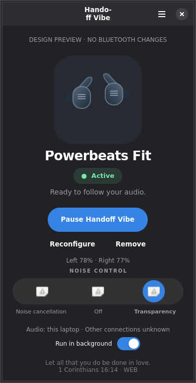
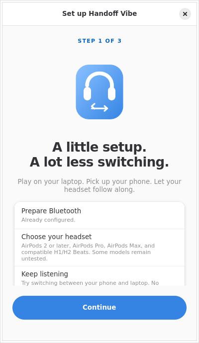
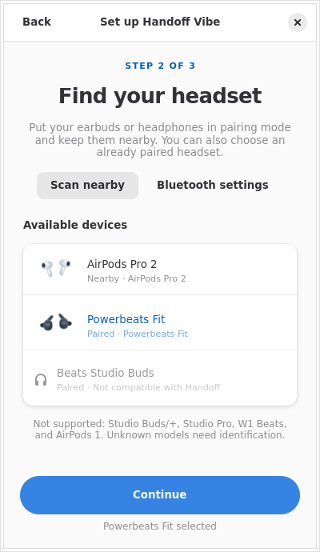
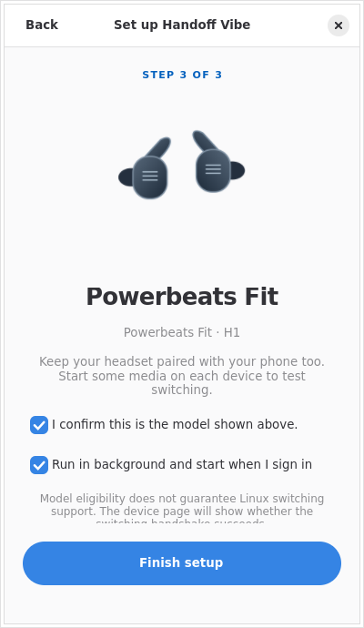
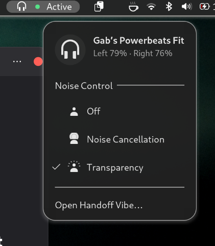

# Handoff Vibe

A small GTK/libadwaita app for switching compatible AirPods and Beats between Linux and Apple devices, with battery and noise controls in the app and GNOME top bar.

[Download 0.2.1](https://github.com/Asensado/Handoff-Vibe/releases/tag/v0.2.1) · [Setup](#installation-and-setup) · [Compatibility](#compatibility) · [What’s changing](#whats-new-in-021) · [Help](#help-and-updates)

> **0.2.1** targets **Debian 13, amd64**. Review the known switching limitation below; other distributions may need a source build.

## What's new in 0.2.1?

**Security improvements**

- Unsigned automatic and in-app administrator updates are disabled. Release checks only show information; installation is a deliberate manual step.
- Python launchers use isolated mode; the ordinary app and engine refuse to run as root. Bluetooth preparation remains a narrow administrator operation.
- Headset commands verify the selected device and the live D-Bus owner before sending controls.
- Configuration validation, private diagnostics, and bounded process cleanup improve failure handling.

**Everyday improvements**

- The installed app window and GNOME integration preferences load correctly again.
- Press **Ctrl+,** to open Preferences, or **Ctrl+L** for Advanced logs.
- **What's new?** in the dotted menu distinguishes Stable, Release candidate, Beta and Experimental builds using coloured badges.
- Setup and update work no longer block the controls queue. Log windows clean up their refresh timers, and stale window callbacks are discarded.
- Handoff, Switching and Active statuses are confirmed locally on Powerbeats Fit; battery and noise controls stay in Handoff's GNOME menu.

**Clear limits**

Automatic connection and the proximity card are greyed out and inactive pending [#17](https://github.com/Asensado/Handoff-Vibe/issues/17) and [#1](https://github.com/Asensado/Handoff-Vibe/issues/1). Ear-removal preferences control **Linux playback only**. Recovery and switching under hardware edge cases remain part of the release checks; spatial audio is future work.

> **Known issue:** charger, browser alert and notification sounds can still cause unwanted switching to Linux. This remains open for 0.2.2 ([#5](https://github.com/Asensado/Handoff-Vibe/issues/5)).

[Security review and implemented fixes](docs/SECURITY-REVIEW-2026-11-26.md) · [Candidate readiness](docs/0.2.1-READINESS.md)



## Installation and setup

You need working Bluetooth and PipeWire-Pulse or PulseAudio. The GNOME companion declares Shell 46–51 support; the local test system uses Shell 48. The app also requires GTK 4.8+ and libadwaita 1.3+, which APT resolves on a compatible system.

### 1. Install the package

Download **`handoff-vibe_0.2.1_amd64.deb`** from the [0.2.1 release](https://github.com/Asensado/Handoff-Vibe/releases/tag/v0.2.1), open a terminal in its folder, and run:

```sh
sudo apt install ./handoff-vibe_0.2.1_amd64.deb
```

You can also open it in a graphical package installer that resolves dependencies. Launch **Handoff Vibe** from your app menu afterward.

### 2. Start the guided setup

Select **Set up a headset**. If the app asks to prepare Bluetooth, approve the administrator prompt. Bluetooth peripherals may briefly disconnect during that one-time step.



### 3. Pair and choose your headset

Keep the headset nearby and put it in pairing mode. Select **Scan nearby**, then choose it. Use **Bluetooth settings** if pairing needs confirmation, or **Identify** if the headset was renamed.



### 4. Confirm and start Handoff

Confirm the model, choose whether to **run in the background**, and finish setup. Keep the headset paired with your Apple device too, then test playback from each device.



*These setup images use demo devices. Accent colours follow your GNOME theme.*

### 5. Enable the GNOME menu

After installation or an extension update, **sign out and back in**. Open **Preferences → GNOME integration → Top-bar status** and enable it.

Handoff's top-bar menu contains batteries, listening time when available, and noise controls. Volume and output selection stay in GNOME's own sound menu.



## Compatibility

| AirPods in the setup catalog | Beats in the setup catalog |
| --- | --- |
| AirPods 2, 3 and 4 | Beats Fit Pro |
| AirPods Pro and Pro 2 | Powerbeats Fit |
| AirPods Max | Powerbeats Pro and Pro 2 |
| | Beats Solo Pro |

**Powerbeats Fit has been checked locally:** changing ANC/Transparency from Handoff works while iPhone audio keeps playing. Other catalog models still need testing across devices, firmware and Bluetooth adapters. Available noise modes, case batteries and proximity reporting depend on the headset.

First-generation AirPods, Studio Buds/Studio Buds +, Studio Pro/Studio3, Solo Buds/Solo3/Solo 4, Flex, BeatsX and W1-only models are outside the supported setup catalog. A matching Bluetooth name alone does not prove compatibility.

## Features

- Device switching controlled by **Start/Pause Handoff**, plus background operation at sign-in.
- Noise cancellation, Transparency and Off controls through the same headset connection, including while another device owns audio. Adaptive is shown in the GNOME menu when supported.
- Left/right/case batteries and a listening-time estimate learned from your own discharge sessions. Unavailable readings are omitted.
- Ear-detection pause/resume, for Linux media players, with Never / Either earbud / Both earbuds settings.
- **Automatic connection is unavailable for 0.2.1**, pending hardware validation ([#17](https://github.com/Asensado/Handoff-Vibe/issues/17)). Its preference is greyed out.
- **Proximity card is unavailable**. A battery notification with a Connect button is planned ([#1](https://github.com/Asensado/Handoff-Vibe/issues/1)); its preference is greyed out.
- Guided pairing, safe import of an existing installation and profile management. CLI export/restore is retired; migration backups remain available.
- **What's new?** in the dotted menu, with Stable, Release candidate, Beta and Experimental release badges and read-only update notifications.
- Advanced logs and an offline daily Bible verse.

## Everyday use

**Run in background** starts the engine at user sign-in and keeps it running when the window closes. **Pause** stops switching for now without removing the profile or pairing.

The top bar shows **Active**, **Switching**, **Handoff** when another device owns audio, **Disconnected**, or **Paused**. A service failure still shows Error.

Normal handoff between connected hosts remains available. Optional automatic connection and proximity cards are disabled while their tracked work is unfinished. Ear-removal pause preferences control Linux media players; iPhone playback follows its own ear-detection setting.

## Help and updates

Open **Menu → Advanced logs** first if something does not work. Handoff keeps a private runtime log even when your account cannot read the system journal.

| Problem | Try this |
| --- | --- |
| Headset missing | Turn on Bluetooth, use pairing mode, move it nearby and scan again |
| Bluetooth connects but controls do not appear | Wear the earbuds, connect them to the laptop and check Advanced logs for a control-channel error |
| An older pairing will not switch | Complete Bluetooth preparation, then remove and re-pair the headset if it cached the old computer identity |
| No case battery or listening estimate | The case may not be reporting; the estimate needs enough listening history |
| Top-bar code looks unchanged | Sign out and back in after the package update, then check the extension is enabled |

Close the old GUI before upgrading. Install the new `.deb` with APT; your profiles remain in place. The optional `INSTALL-UPDATE.sh` release asset also stops/restarts the managed engine for an upgrade.

**Preferences → Updates** controls read-only release checks. **Automatic and in-app privileged installation are disabled** until an independently authenticated release-signing channel is available. A checksum obtained from the same GitHub API as a download is an integrity check, not an independent publisher signature. Download and deliberately install packages yourself after reviewing their release/source.

If you still run the published 0.2.0 build, turn off **Update after APT refresh**. You can also disable its old hook with:

```sh
sudo /usr/bin/python3 -I /usr/libexec/handoff/update-handoff disable
```

Upgrading to the reviewed code removes the old APT update hook and opt-in marker. This source change does not retrofit already-installed older builds. The security review and fixes are recorded in [docs/SECURITY-REVIEW-2026-11-26.md](docs/SECURITY-REVIEW-2026-11-26.md).


To uninstall, remove the headset profile or stop its background service first, then:

```sh
gnome-extensions disable handoff-vibe@asensado.github.io
sudo apt remove handoff-vibe
```

Profiles and pairing are retained. Removing the package does not undo the one-time Bluetooth Device ID preparation. CLI transfer is retired. Original migration backups are kept for reference; Handoff Vibe does not create an independent CLI installation.

## Development

### Build on Debian 13

```sh
sudo apt install build-essential cmake dpkg-dev qt6-base-dev qt6-connectivity-dev \
  meson ninja-build pkg-config libglib2.0-dev libbluetooth-dev gettext \
  python3 python3-gi gir1.2-gtk-4.0 gir1.2-adw-1 libavcodec-dev libpipewire-0.3-dev
python3 packaging/build-deb.py
```

The native-architecture package is written to `dist/`. Build against your distribution's libraries rather than assuming the Debian binary works on older Debian/Ubuntu versions.

### Preview and test

```sh
python3 handoff-vibe --demo --theme dark
bash VERIFY-LOCAL.sh
GDK_BACKEND=x11 GSETTINGS_BACKEND=memory xvfb-run -a python3 tests/ui_smoke.py
```

The full checks additionally use Node.js, GJS, Xvfb, Xauth and ImageMagick. Regenerating the original artwork uses `librsvg2-bin` and `python3 packaging/render-device-art.py`. Demo mode uses sample devices and does not change Bluetooth or migrate services. Test results and remaining live checks are recorded in [VALIDATION.txt](VALIDATION.txt).

### Architecture and useful paths

The GTK app and user-service supervisor communicate over D-Bus with a separately executed, modified Earport backend. That backend owns the selected headset's control channel. Do not run a separate Earport service alongside it. The earlier Qt engine remains available as a troubleshooting fallback.

| Purpose | Path |
| --- | --- |
| Profiles | `~/.config/handoff/gui.json` |
| CLI migration backups | `~/.config/handoff/backups/` |
| Backend configuration/keys | `~/.config/handoff/engine-config/earport/` |
| Service | `handoff@<MAC-without-colons>.service` in the systemd user session |
| Runtime status/logs | `$XDG_RUNTIME_DIR/handoff/<MAC-without-colons>.json` and `.log` |
| GNOME companion | `handoff-vibe@asensado.github.io` |

Configuration paths honour `XDG_CONFIG_HOME`. The release workflow builds on Debian 13, runs tests, renders demo setup images into the release source archive, and attaches the package, complete source and checksums. It does not push to main. Branch rules and rollback procedures are documented in [docs/MAINTAINING.md](docs/MAINTAINING.md). [RELEASE.json](RELEASE.json) records the intended tag and prerelease status.

## Credits and licenses

| Component | License and attribution |
| --- | --- |
| Handoff GTK app and original integration | Asensado, GPL-3.0-or-later |
| Original Qt Handoff engine | [xatuke/handoff](https://github.com/xatuke/handoff), MIT |
| Earport backend and integrated GNOME companion | [Anoryth/earport](https://github.com/Anoryth/earport), GPL-3.0-or-later; corresponding source and build files are included |
| Protocol research | LibrePods and its contributors, credited in [earport/CREDITS](earport/CREDITS) |
| UI inspiration | [Packet](https://github.com/nozwock/packet); no Packet code or artwork is copied |
| Bible text | World English Bible, public domain |

Handoff Vibe is free software under GPLv3 or later, including for personal, commercial and educational use. When distributing covered software, preserve copyright/license notices and meet GPL corresponding-source obligations. Original MIT code keeps its MIT permissions. The bundled device illustrations are original GPL artwork, not manufacturer photos; device names remain their owners’ trademarks. See [LICENSING.md](LICENSING.md), [THIRD_PARTY.md](THIRD_PARTY.md), [NOTICE](NOTICE) and the included license texts.

### A message from Asensado

Hi there! At the time of writing, I'm still a first-year university student taking Computing Science. This was just a curiosity project and I'm surprised this worked great on a trial of ChatGPT Plus Work. I know vibe-coded stuff is ew, and I do plan on actually not relying on AI to code my ideas. This was just a QoL to a project I use daily, and I hope it's useful to you too. Thanks for taking the time to read this. God bless!
